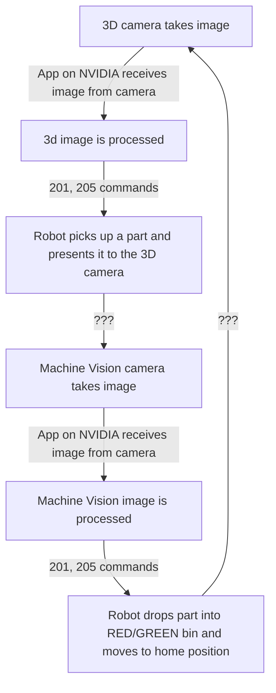

## Reason for using two cameras
We have two different tasks:
- 3D position+orientation estimation, suited for a low resolution 3D camera
- ACCEPT/REJECT classification for parts, suited for a high resolution 2D machine-vision camera
## Loop of events

### Open Questions
- Can we wait a few seconds for the image to process before we start the 201 and 205 command?
	- Alternatively, can the 205 response be delayed by a few seconds? When does the request timeout?
- How do we command the cameras to take images? Possible options:
	- Some way to tell the NVIDIA device via a TCP/IP command that we are ready to take an image?
- %%%%