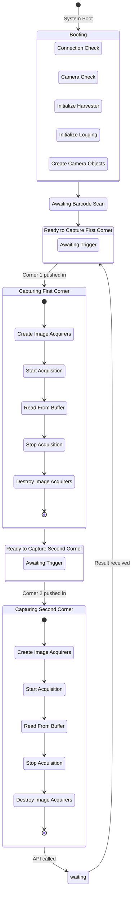

# Details of Assa-Abloy Project Components

## Hardware
 - Jetson Nano with a 3-channel-relay HAT to control the stacklights.  
 - Invisible-eye sensor looking at a retro-reflector, which detects when we have an obstruction, and sends that signal (via a relay) to the Jetson.  
 - Cameras connected to a local network, on an onboard network switch.
 - Barcode scanner connected to Jetson
 
Almost everything is housed inside a metal box we've affectionately named "Wilson"^[after the basketball in the movie "Cast Away"].  
The stacklight is attached to Wilson externally.  
The cameras and sensor are mounted on the testing structure, and are wired to external ports provided on Wilson.

[Detailed Wiring Diagram](Panel%20wiring%2020Sep22_1530.pptx)

[How to use barcode scanner inside a background script](https://github.com/vpatron/barcode_scanner_python)

## Onboard Software
There is a service script that calls the following scripts:
 - uploadScheduler.py that uploads the logs once every 3 hours
 - resourceLogger.py that logs resource usage data every 5 minutes
 - main.py that is the main application
	 - This is in a while True loop so that whenever it crashes, it restarts again
	 - This depends on the following modules:
		 - camera.py operates the camera
		 - stacklight.py operates the stacklights and the sensor

## Server-side Software
The server receives images and looks for angle or surface defects, and sends the final result back to the Jetson Nano.

Angle detection works as follows:
1. Template matching to identify the corner
2. Cropping the required area
3. Masking out the background
4. Thresholding pixel luminances to determine which pixels belong to the frame
5. Edge detection on the binary thresholded image
6. Line detection on the edge image
7. Filtering out most prominent horizontal and vertical lines
8. Finding angle between them

Defect detection works with a mask R-CNN.

*[HAT]: Hardware Attached On Top